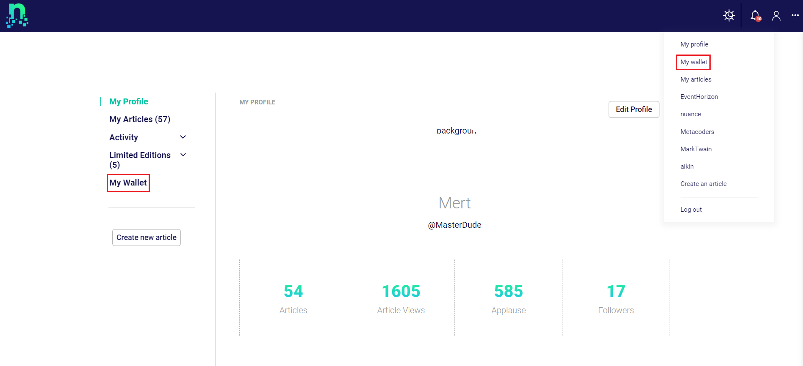
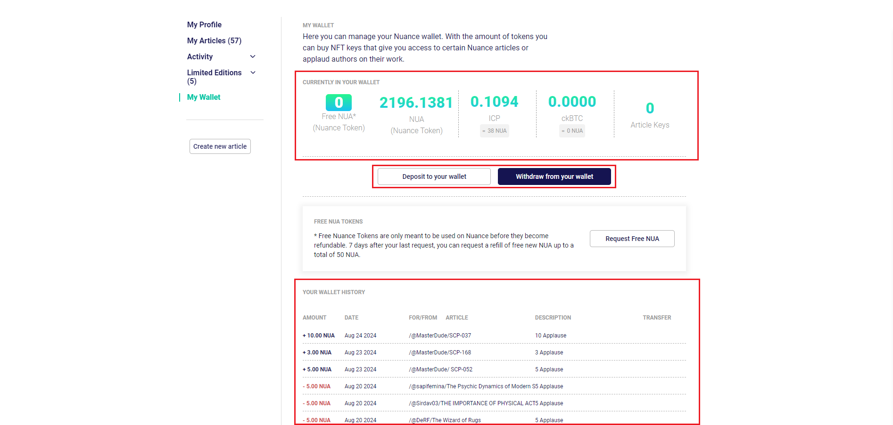
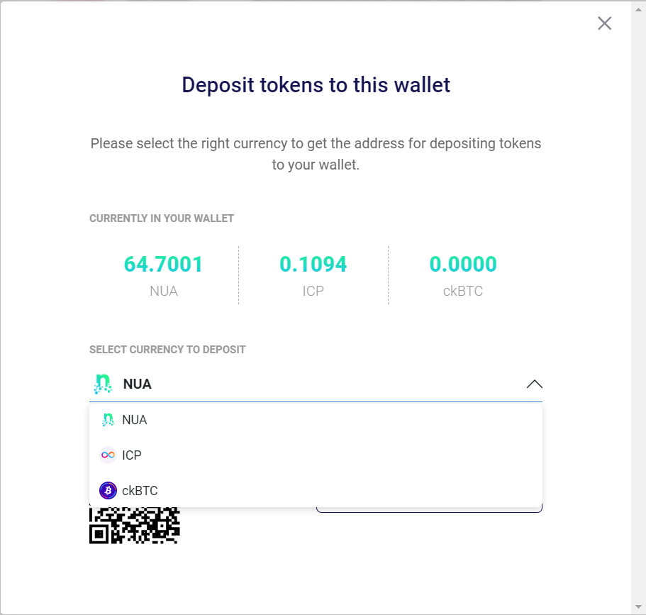
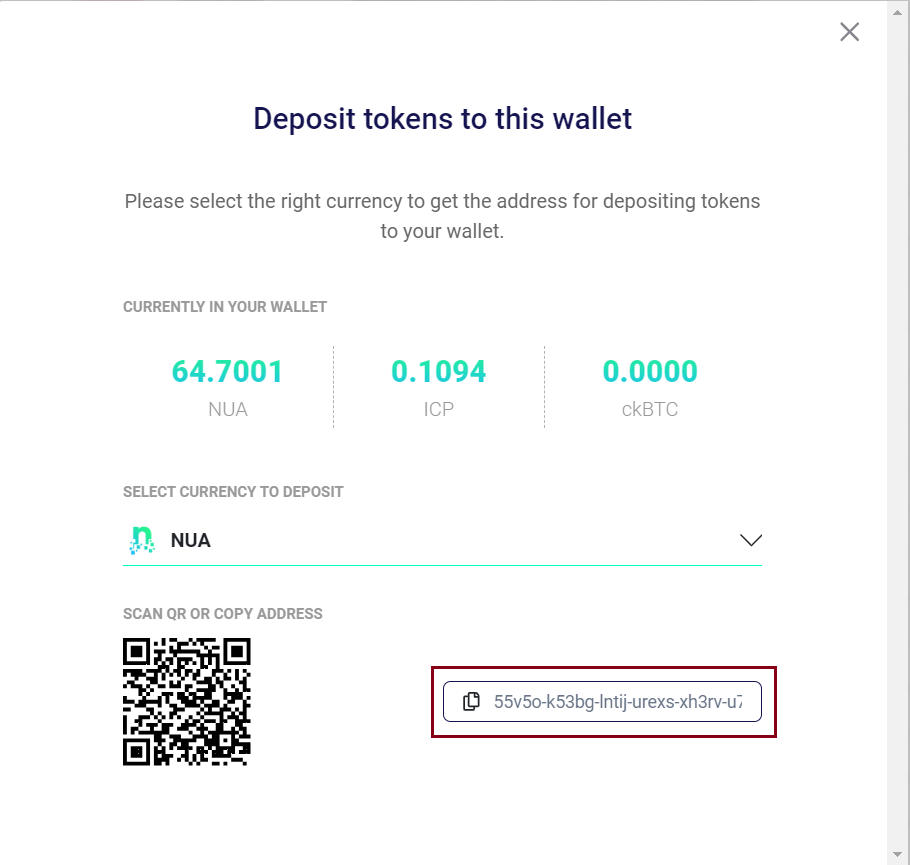
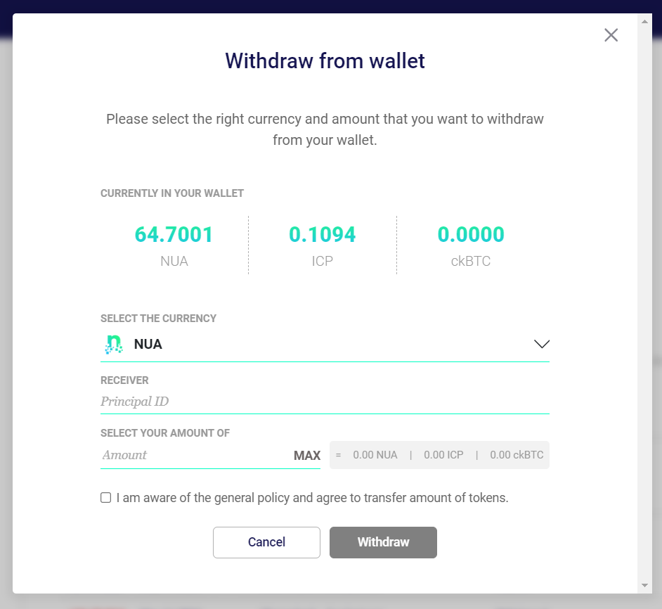

# Getting Paid / Wallet

You can access your wallet to check and manage your tokens that you can use on Nuance. You will frequently visit your wallet to control your balance and check the tips coming into your articles. To access your wallet, simply click on **My wallet** after clicking the **profile icon**, or alternatively, click on My wallet from the left panel on your profile page.

<figure><figcaption>
Accessing to Your Wallet
</figcaption></figure>

Statistics such as your wallet balance and other related information will be displayed in the center of the screen. You can send and receive tokens by clicking the Deposit and Withdraw buttons below. Your transaction history will be displayed in the bottom feed.

Earnings from your articles are also reflected in this balance. This provides a clear view of tips, subscriptions, and other reader support in one place, making it easier to track the direct value your work generates.

<figure><figcaption>
Your Wallet
</figcaption></figure>

When you click the **Deposit button**, a modal will appear with the necessary information for transferring tokens to your wallet. When you select the type of token you want to deposit into your wallet, the modal displays the address you can use for transfer. You can add ICP, NUA, and ckBTC tokens to your wallet.

<figure><figcaption>
Selecting Currency to Deposit
</figcaption></figure> <figure><figcaption>
Your Deposit Address
</figcaption></figure>

You can use the **Withdraw button** to withdraw balance from your wallet. The opened modal will ask you which token you want to withdraw, the withdrawal address and how much you want to withdraw. Your transfer will be confirmed once you have entered the required information, accepted the general policy, and pressed the withdraw button.

<figure><figcaption>
Withdrawing Modal
</figcaption></figure>
