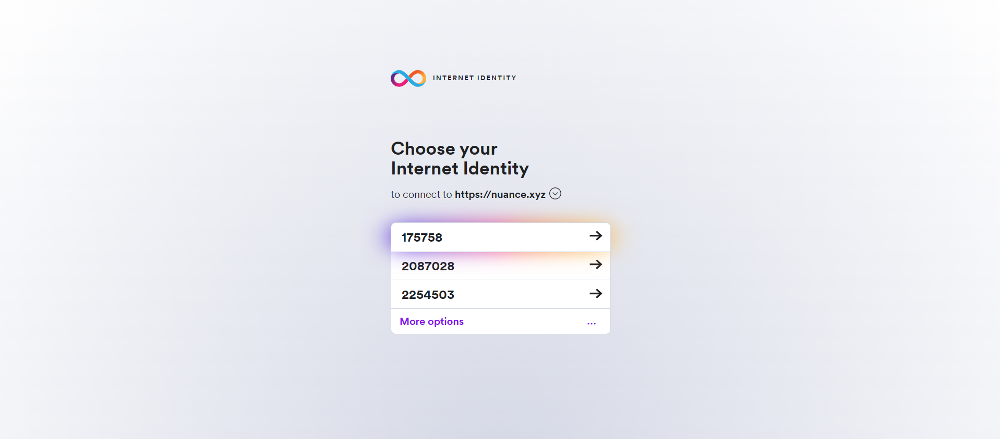
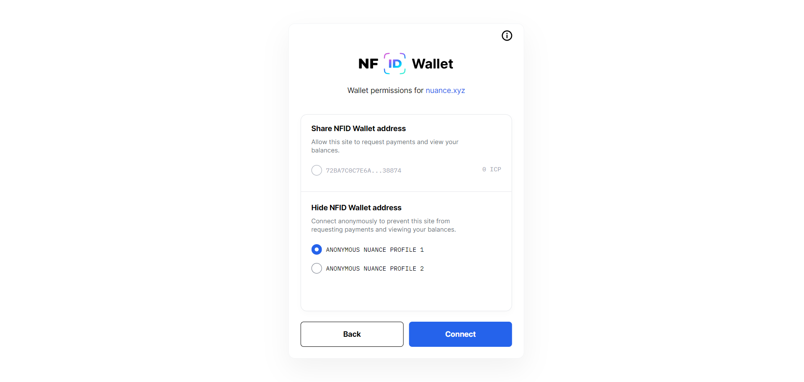

# How to Login

If you [registered](how-to-register.md) using Internet Identity, Google NFID, Stoic Wallet, or Bitfinity Wallet, clicking on the corresponding button in the login panel on the home page will take you directly to the login flow. Clicking **Other options** will display all available login methods.&#x20;

<figure><figcaption>
Login Panel
</figcaption></figure>

For example, if you registered with Internet Identity, the flow will verify your user identity and log you in.

<figure><figcaption>
Internet Identity Login Authorization
</figcaption></figure>

NFID login flow will look like this:

<figure><figcaption>
Google NFID Login Authorization
</figcaption></figure>
