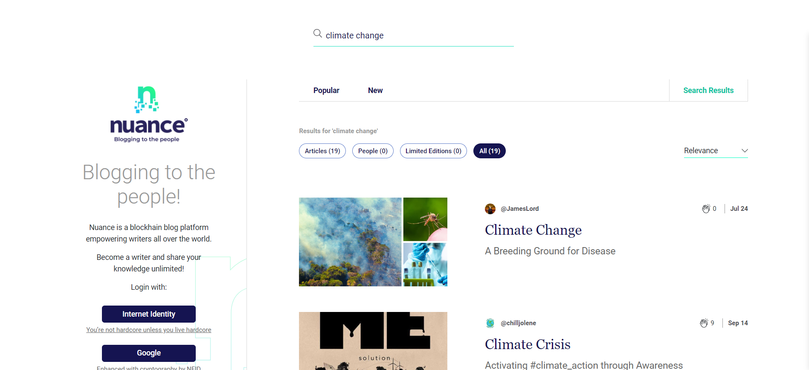

# How to Use Search Bar

You can use the Search Bar feature to easily find articles, people, Limited Editions and topics. To access the search bar, just click on the articles tab on the home page. You don't need to register or log in to use this feature.

<figure><figcaption>
Search Bar in Action
</figcaption></figure>

Your search results will be categorized as Articles, People, Limited Editions and All for easy access. You can browse the sorting options from the dropdown menu on the right of the screen.

**Searching with hashtags** is useful when you want to search on spesific topic. For example, searching **technology** with hashtag will allow you to find and [follow](../social-interactions/how-to-follow-things.md) this topic.

<figure><figcaption>
Searching Topics With Hashtag
</figcaption></figure>
