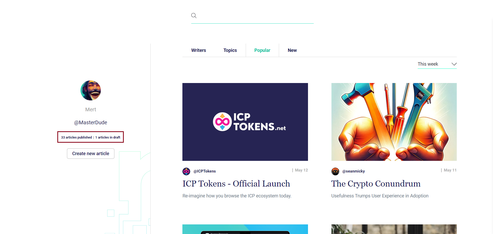
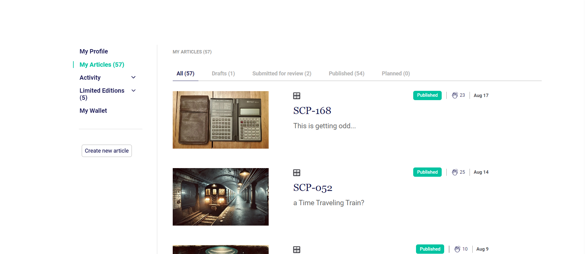
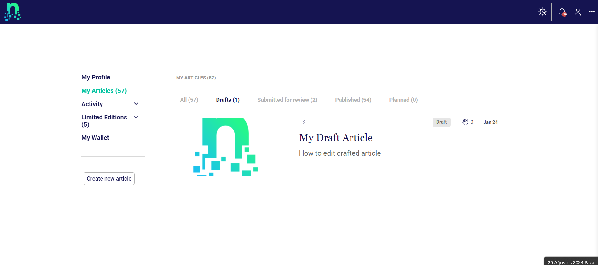

# My Articles

On the **My articles** page, you can find your drafts, the articles you have published so far, or the articles you have sent for review if you are writing for a [Limited Edition](../publications/).&#x20;

You can click My articles on the Navigation Menu, click **My articles** on your profile page, or click **x articles published** below your profile picture on the home page to access your articles.

<figure><figcaption>
Access Your Articles Via Your Profile
</figcaption></figure> <figure><figcaption>
Access Your Articles Via Home Page
</figcaption></figure>

You may view your articles in various statuses using the My Articles tabs on the My Articles page. For example, the **Drafts** tab displays articles you have saved to work on but have not yet published, while the **All** tab lists all of your articles regardless of publication status.

<figure><figcaption>
Your All Articles
</figcaption></figure> <figure><figcaption>
Your Drafts
</figcaption></figure>

