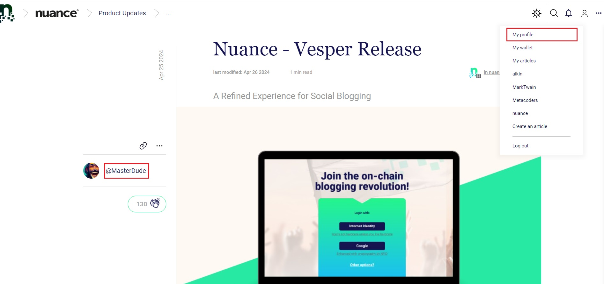
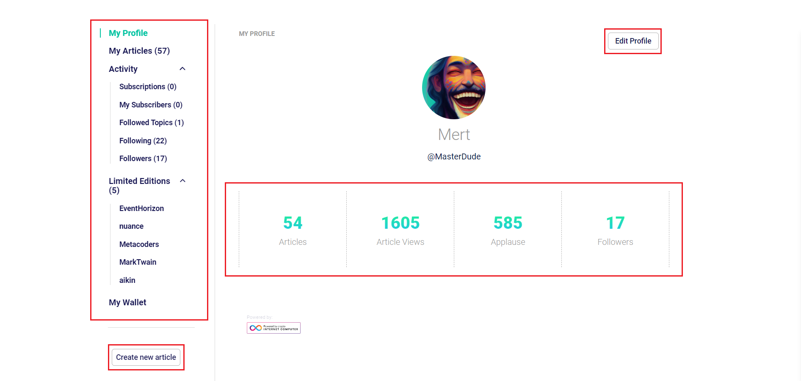
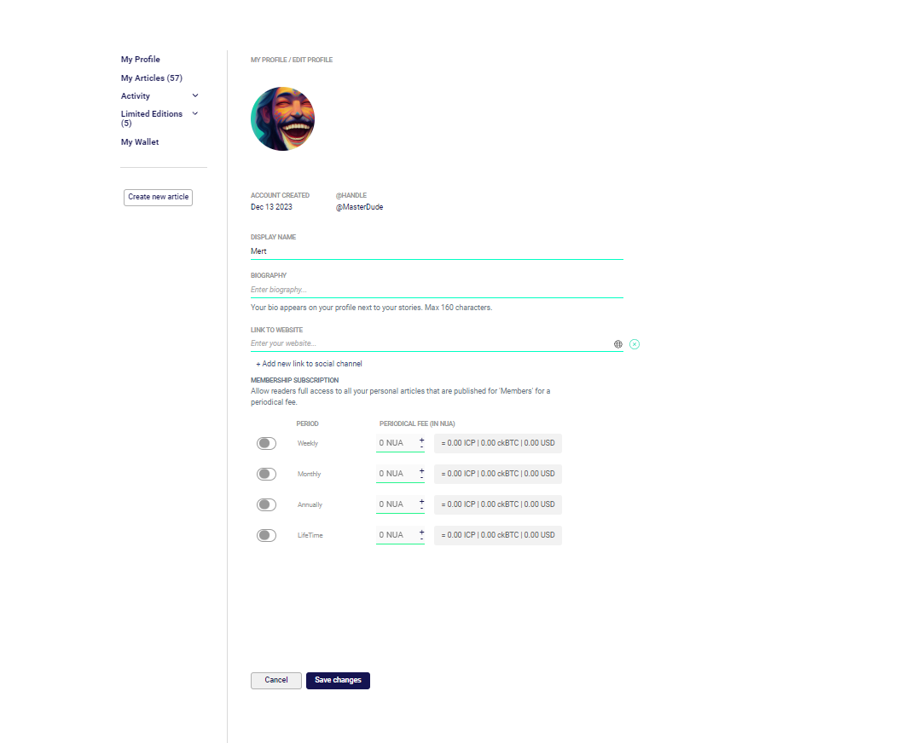

# My Profile

Your profile home page allows you to view various statistics about your time at Nuance, as well as access your articles, Limited Editions, and activities. You can also update the information in your profile from this page.

To access your profile page, you can click the **Profile Icon**, then click **My profile**. Alternatively, clicking your username on the left will take you to your profile.

<figure><figcaption>
Accessing Your Profile
</figcaption></figure>

Your profile statistics will appear in the middle of your profile page. On the left, there is a panel where you can view your articles, followers, people and topics you follow, [subscriptions ](../subscription/)and subscribers, wallet, and active Limited Editions. There is a button right below that allows you to quickly create a new article. In the upper right corner, there is a button that takes you to the profile edit page.

<figure><figcaption>
Your Profile
</figcaption></figure>

You can change the display name, biography and the links of your active websites on the profile edit page.

<figure><figcaption>
Editing Your Profile
</figcaption></figure>
