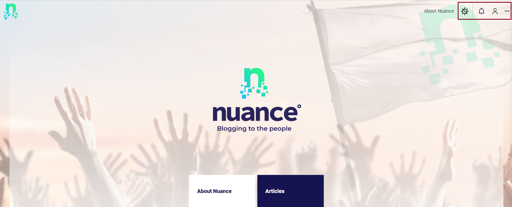
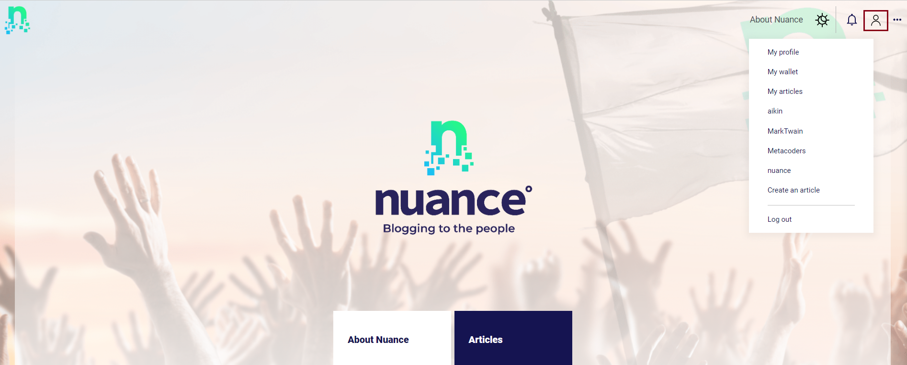
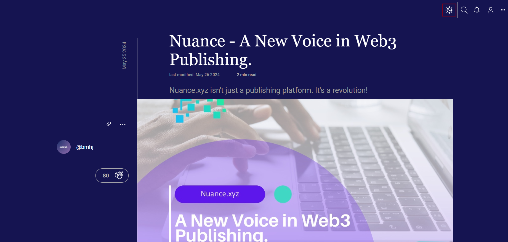

# Navigating Through Menus

In the upper right corner, you will see a set of icons representing simple functions and a navigation menu when you sign in.This allows you to easily access your articles, Limited Editions, profile, wallet, and article NFTs or get started writing with a single click. It also allows you to quickly make searches, access your notifications, and switch between dark/light modes.

<figure><figcaption>
Menu Bar
</figcaption></figure>

When you click on the **profile icon**, you will see options that allow you to easily access your articles, Limited Editions and wallet. You can also go to your article creation screen with a single click from this menu.

Alternatively, you can access your [articles](my-articles.md), [Limited Editions ](../publications/)and [wallet ](getting-paid-wallet.md)via the navigation panel on your profile page. These navigational features are effective in taking you to the page you want to go to without the hussle.

<figure><figcaption>
Profile Icon
</figcaption></figure>

The **bell icon** represents your notification panel. [Notifications ](notifications.md)keep you informed about what's happening and keep you in the loop.

Want to make it easy for your eyes? You can switch between Dark and Light modes with **Sun/Moon icon**.

<figure><figcaption>
Dark Mode Enabled
</figcaption></figure>

By clicking on the **Meatball menu** (3 dots), you can access pages where you can get information about Content Rules, Terms & Conditions and Privacy Policy, as well as access our community platforms such as Discord and OpenChat.
