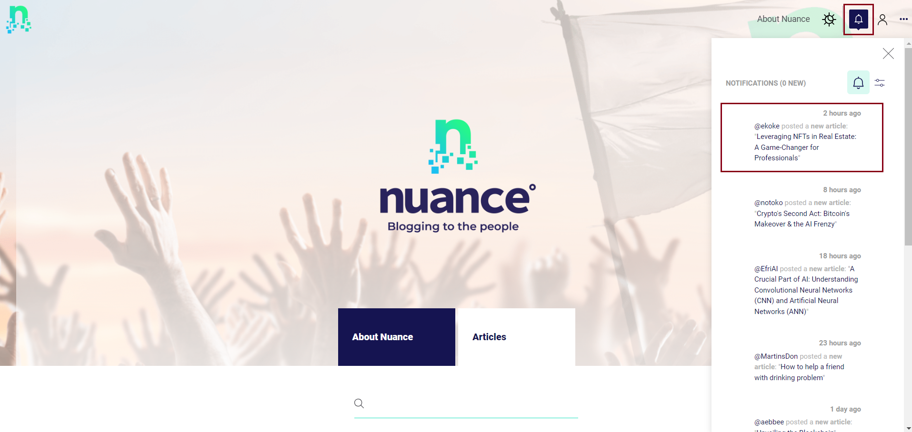
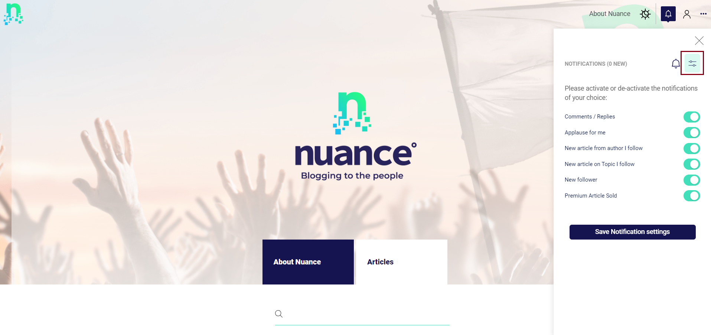

# Notifications

Get connected with people, stay informed about articles, and always be in the loop with the notification system.

Notifications will keep you updated on comments and replies, applause recieved, new followers, new articles from authors or topics you follow, new subscribers, and sold premium articles.

The **bell icon** in the upper right corner will notify you if there is a new notification. Just click on the icon to see details about your notifications.

<figure><figcaption>
Notifications Sidebar
</figcaption></figure>

You can change your notification preferences for comments and replies, applause received, topics and authors you follow, new followers and premium articles by clicking the **settings icon** in the notification panel.

<figure><figcaption>
Notification Preferences
</figcaption></figure>
