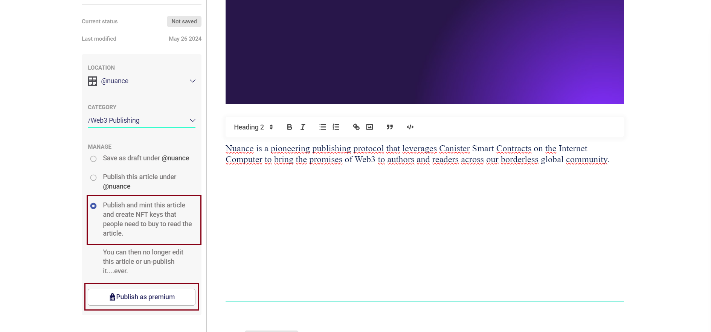
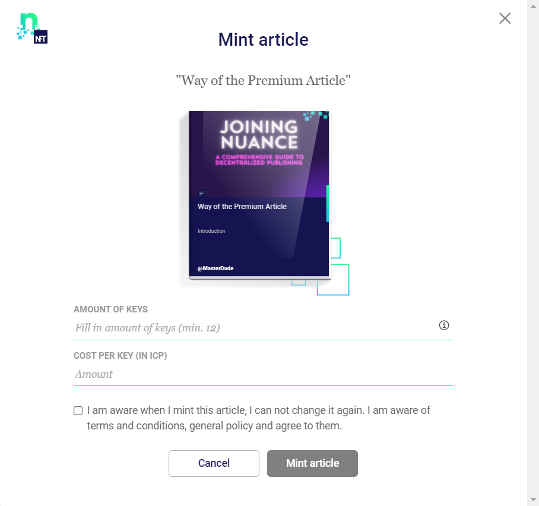

# How to Sell a Premium Article

Premium Articles are currently available only for Limited Editions.

Premium Article creation flow is similar to standard article creation flow. After entering your title, introduction, body, and tags, select which Limited Edition you want to continue with from the left panel, then click the **Publish and Mint** option and press the **Publish as Premium** button.

<figure><figcaption>
Setting Up a Premium Article
</figcaption></figure>

After you press the button, you must enter the required information in the pop-up window for minting the article.

<figure><figcaption>
Minting The Premium Article
</figcaption></figure>

You can continue your minting process after entering how many keys you want to produce and the price you want for each key in the relevant fields.&#x20;

The amount of editors who have access to the Limited Edition are automatically given a key. You cannot mint fewer articles than the number of editors in your Limited Edition. Once you publish your Premium Article, it cannot be edited or unpublished.&#x20;
