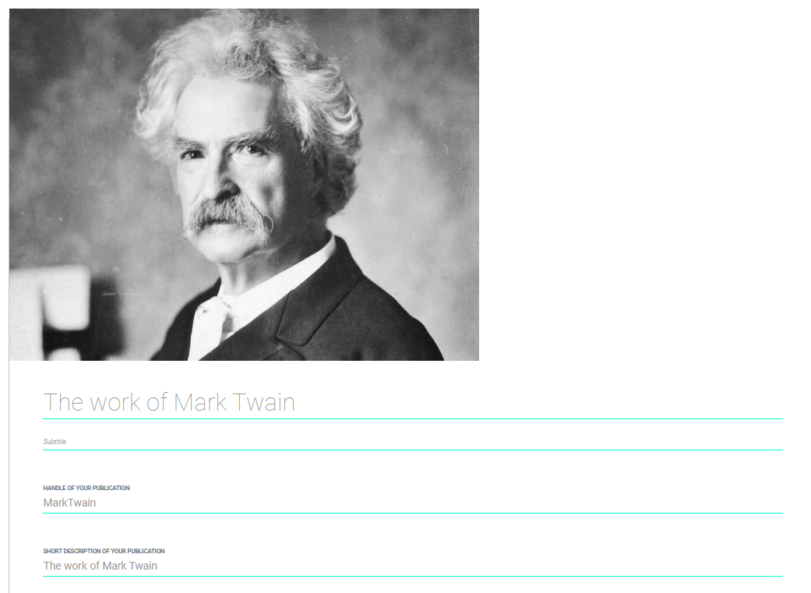
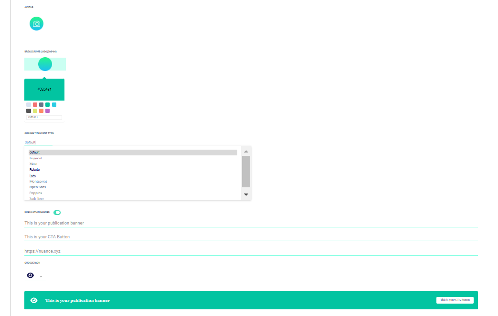
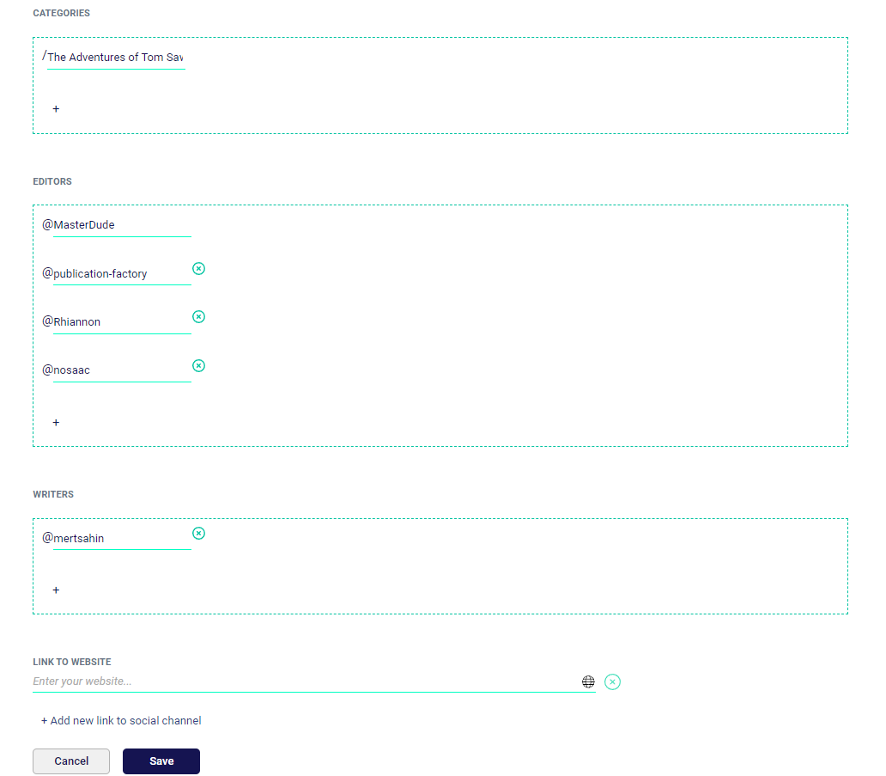

# How to Customize Your Publication

Once you have the Publication created, you can start customizing your Publication.

To do this:

1. Click on your **profile icon** top right of screen
2. Click on **My profile**
3. On the left-hand menu you will see **Publications**
4. Select your Publication
5. Alternatively click on your avatar icon top right of screen and simply click your Publication's name
6. Select **Edit Publication**

<figure><figcaption>
Editing a Publication
</figcaption></figure>

There are multiple things you can customize in your Publication:

* Upload header image (preferably landscape orientation). This will be displayed at the top of your landing (home) page. It will also display on each category page (with a reduced height).
* Add title. This will be overlayed on your header image.
* Add a sub-title. This will be overlayed on your header image.
* Add a short description. This will be displayed on the left-hand side panel underneath your avatar.

<figure><figcaption>
Header Image, Title, Subtitle, and Description.
</figcaption></figure>

* Add an avatar.
* Add a logo for the breadcrumb menu (208px\*66px).
* Choose your color for the trim.
* Choose your font.
* Toggle and edit your Publication banner (CTA).

<figure><figcaption>
Avatar, Logo, Color, Font, and Banner Options.
</figcaption></figure>

* Add categories.
* Add your editors.
* Add your writers.
* Add links to your other social platforms.

<figure><figcaption>
Categories, Editors, Writers, and Social Links.
</figcaption></figure>
