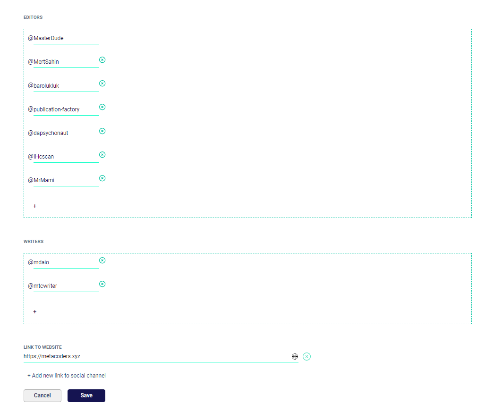

# How to Manage a Publication

Publishers can manage articles and contributors. \
\
Publications have two levels of contributors:

* **Editors** who can write, edit, and publish. Editors have two roles: managing articles and Publication (e.g., reviewing and approving articles for publication and managing the Publication by editing font, color, avatar, banner or other customization options ) and managing contributors (e.g., adding new writers to your Publication).
* **Writers** who can write and submit for approval to an editor.

To add new contributors to your Publication, simply click on the **Edit Publication** button:

<figure><figcaption>
Editing a Publication
</figcaption></figure>

Enter the user handle in the Editors or Writers section at the bottom of the Publication customization page, and then click on the save button:

<figure><figcaption>
Adding Contributors
</figcaption></figure>

Other information you should consider:

* You can have more than one Publication
* Publication handle cannot be changed
* Publication title can be changed
