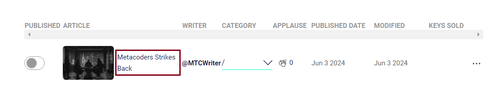
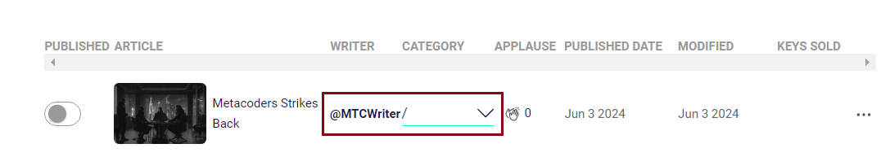
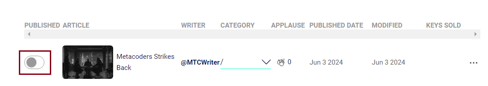

# How to Manage Articles (For Editors)

Editors can manage articles by reviewing, editing and publishing them.&#x20;

Articles submitted by authors will appear on the Publication page for editors to review:

<figure><figcaption>
Article List and Submitted Article
</figcaption></figure>

To manage articles, editors can:

Click on the article link and review the article:

<figure><figcaption>
Article Link
</figcaption></figure>

Click on the meatball menu to edit, publish, or mint the article:

<figure><figcaption>
Meatball Menu
</figcaption></figure>

Categorise the article into one of your categories:

<figure><figcaption>
Category Dropdown
</figcaption></figure>

Select the toggle to publish and unpublish:

<figure><figcaption>
Toggle Button
</figcaption></figure>
