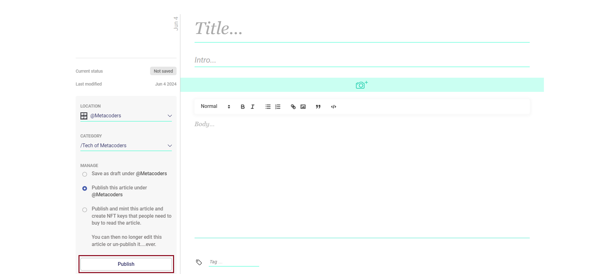

# How to Write for a Publication

Publications have two levels of contributors:

1. Editor (can write and publish)
2. Writer (can write and submit for approval to an editor)

To write an article as a writer within a publication, you [create an article](../publishing-articles/how-to-create-an-article.md) as usual. On the left-hand side of the screen, you have a **Location drop-down** where you can select either your own handle or the handle of a publisher.&#x20;

When you submit to Publication, the article is submitted to the editor, and the article is no longer available for you to edit.

<figure><figcaption>
Submitting an Article For Review
</figcaption></figure>

If you are an editor, after creating the article, you can save it as a draft, select a category, and publish the article directly.

<figure><figcaption>
Publishing Directly as Editor
</figcaption></figure>
