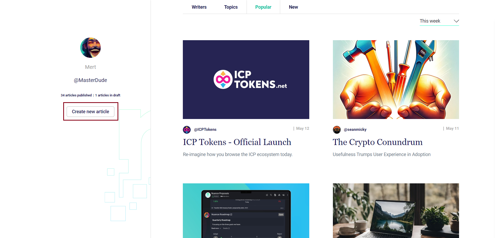
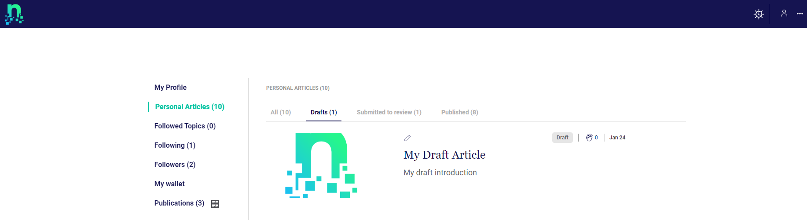

# How to Create an Article

To create a blog post you first need to be a [registered user](../getting-started/how-to-register.md) and logged in.

To create a post select the **Create new article** button at the left-hand side of the screen (or click on the **profile icon** top right and **Create article**). This will take you to a page where you can add a title, an introduction, a body and add between 1 and 3 topics (tags).

The title is text only without formatting.

The introduction is text only without formatting.

The body is a standard editor with formatting capabilities in the formatting toolbar.

Topics (tags) are predefined coming from a list of 103 topics. You must add between one and three topics to an article.

When you make the necessary edits for your content, you can publish your article by clicking the **Publish this article under @UserName** option on the left panel and then clicking the **publish button**.

Alternatively, you can save your article as a draft without publishing it by using the **Save as draft under @UserName** option on the left panel. To access the content you drafted, simply click on your profile icon, click on **Personal Articles** from the dropdown menu, and select the **Drafts** tab.

<figure><figcaption>
Drafted Articles
</figcaption></figure>
