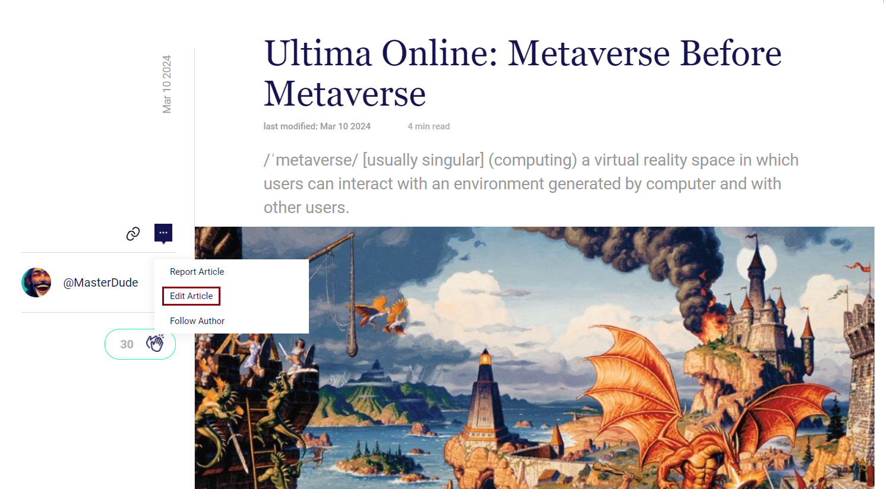
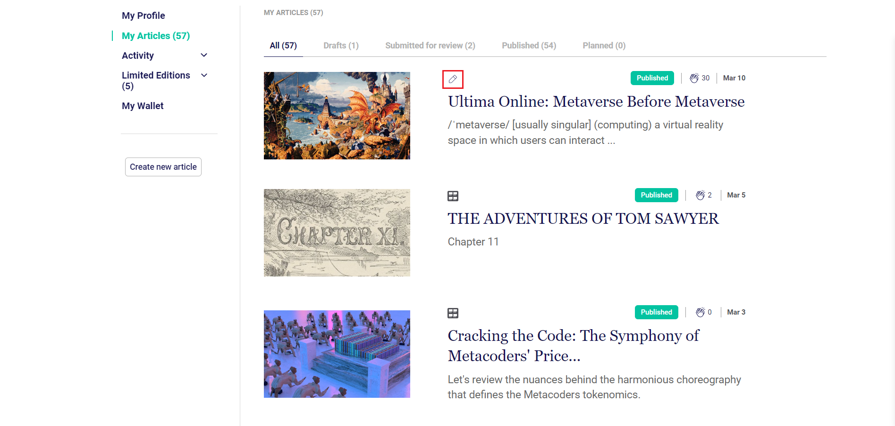
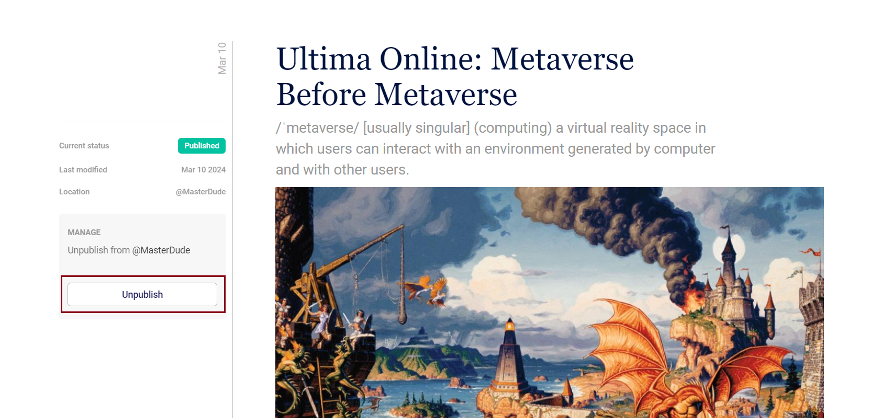
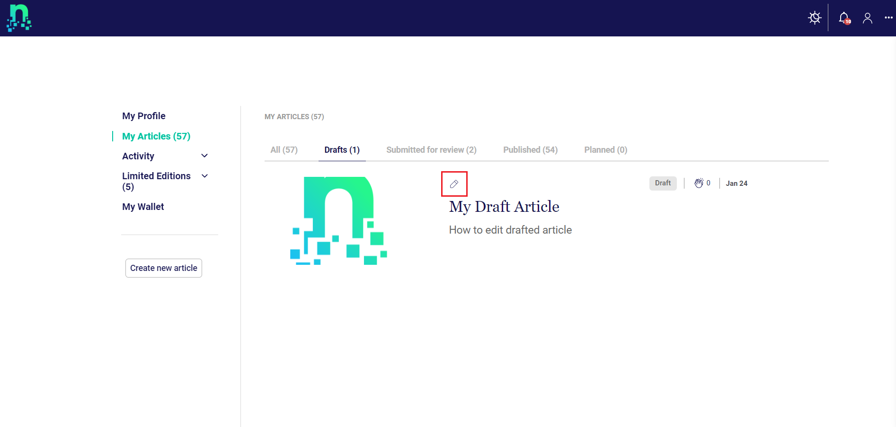

# How to Edit an Article

There are many ways to edit an article after it has been published.

## From the article screen

Click on the left-side meatball menu \[...] and select **Edit Article**:

<figure><figcaption>
Edit Article
</figcaption></figure>

## From the \[My Articles] screen

On your **My articles** screen you can edit published articles by clicking on the **pencil icon** next to each article:

<figure><figcaption>
From My Articles Screen
</figcaption></figure>

This screen can be reached by either clicking on the top-right [profile icon](../getting-started/navigating-through-menus.md) and selecting [**My articles**](../getting-started/my-articles.md), or by clicking on the **x articles published** link under your profile on the front page.&#x20;

To update your content, first unpublish your blog post using the **Unpublish button** on the edit page. This will unpublish your article and mark it as a draft. Following this step, you can make the necessary changes. After making changes, you can republish your article or save it as a draft.

<figure><figcaption>
Unpublishing
</figcaption></figure>

If you want to edit an article that you have previously saved as a draft, simply click on Drafts in the My Articles section and then click the pencil icon.

<figure><figcaption>
Editing a Draft
</figcaption></figure>
