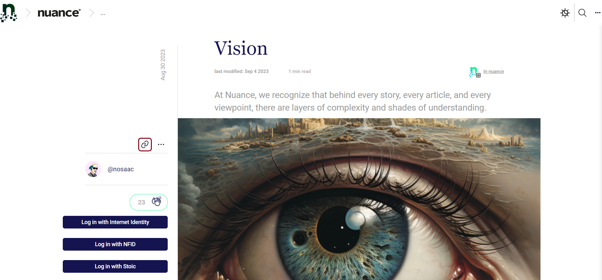

# How to Share an Article

You can find how to share your article with the world here. Sharing is caring.

To share an article from the 'reading' screen:

1. Select **Share** and a deep link to the article will be copied to your clipboard.
2. Share the link anyway you like e.g. Twitter

<figure><figcaption>
Sharing
</figcaption></figure>
