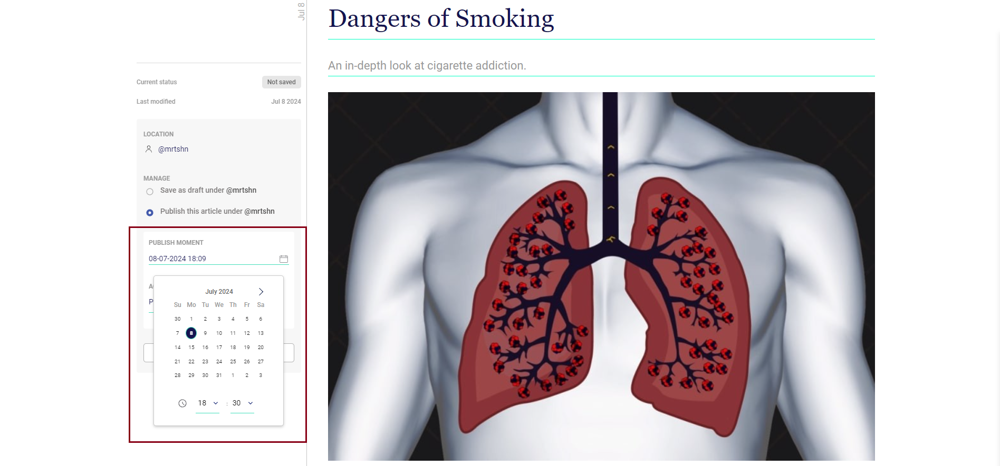

# Scheduled Posts

Scheduled posts is a feature that allows you to save time and speed up your workflow. It allows you to automatically publish the content you have prepared at a specific date and time.

After preparing your content, simply click on **PUBLISH MOMENT** from the panel on the left of the article creation screen and select the date and time you want. Your article will be automatically published on the date and time you enter.

<figure><figcaption>
Setting Up a Scheduled Post
</figcaption></figure>

