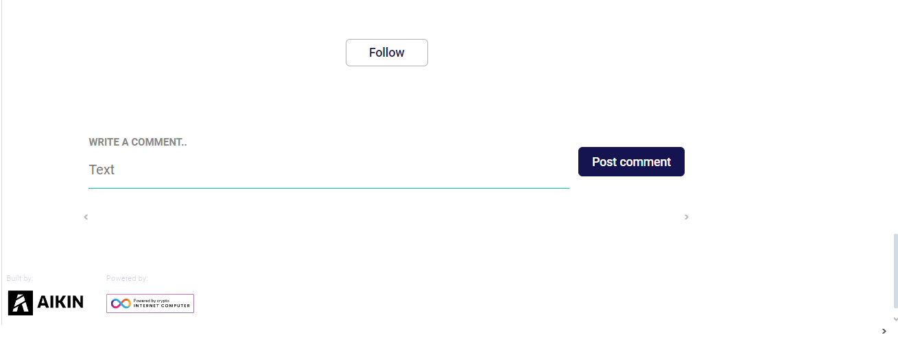

# How to Comment

Commenting on articles is an effective and fun way to interact with the community and share your thoughts on the content. To comment, you can use the comment panel at the bottom of the page where the article is located.

<figure><figcaption>
Commenting Panel
</figcaption></figure>

