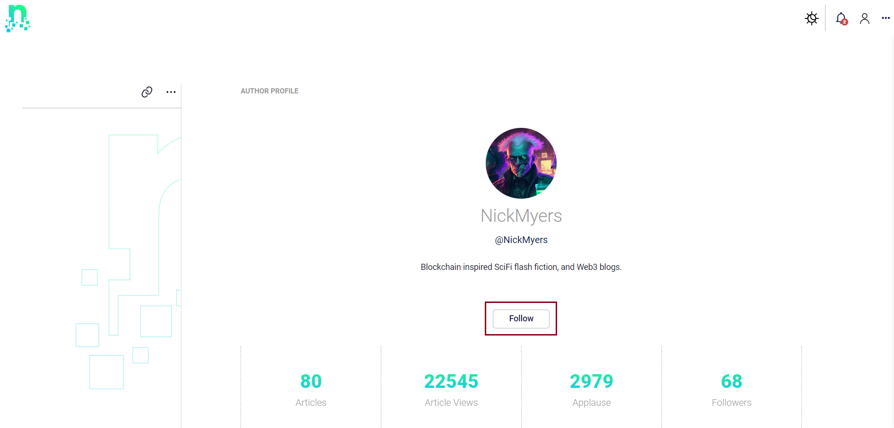
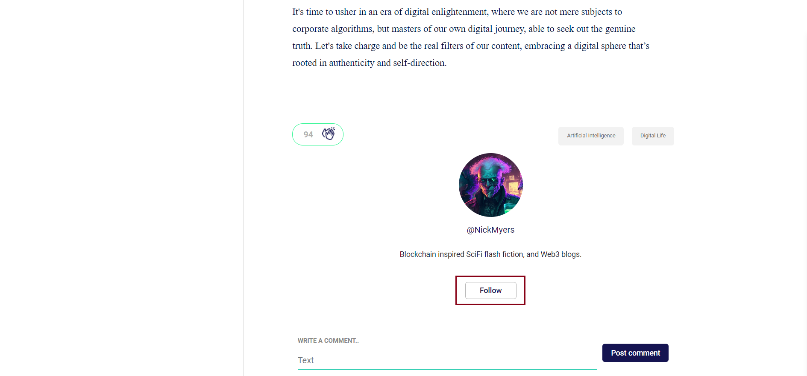
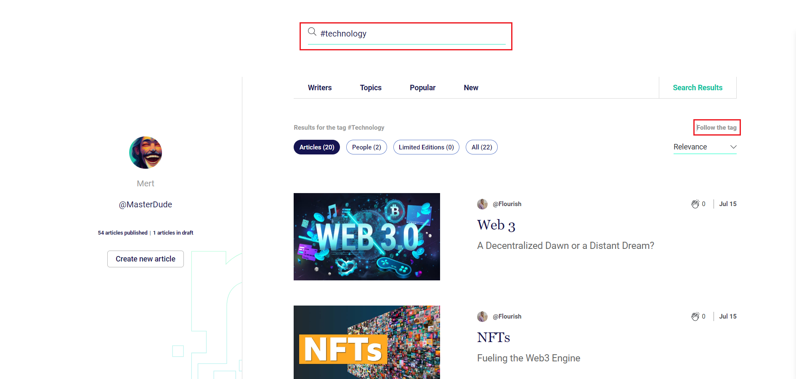

# How to Follow Things

Follow writers or topics to control your homepage.

When logged in, you have four tabs on your home page:

* Writers - Writers you follow
* Topics - Topics you follow
* Popular - The most popular articles (applause x views)
* New - The newest articles

To follow a writer you need to click on their handle @handle and then click the **Follow button**.

<figure><figcaption>
Following a Writer
</figcaption></figure>

Alternatively, you can use the follow button under the article page.

<figure><figcaption>
Following From Article Page
</figcaption></figure>

To follow topics, simply click on the tag at the bottom of the page. This will automatically search for the tag you clicked in the search bar and display the results. Click **Follow the tag** to follow. Alternatively, you can search for other topics by using hashtags (#) in the search bar.

<figure><figcaption>
Cliclking The Tag For Search
</figcaption></figure> <figure><figcaption>
Searching and Following Tags 
</figcaption></figure>

