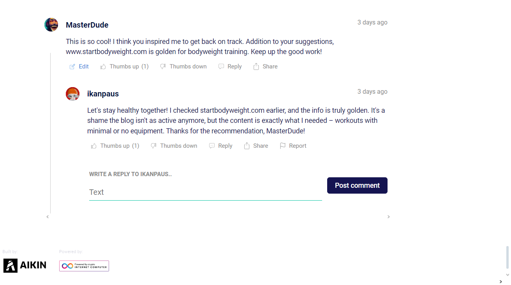

# How to Reply

You can respond not only to articles but also to other user comments. For this, you can use the **Reply** button below the user comment. You can also edit your previous comments from this panel and give **Thumbs up** and **Thumbs down** to other user responses.

<figure><figcaption>
Having a Conversation Through Replies
</figcaption></figure>
