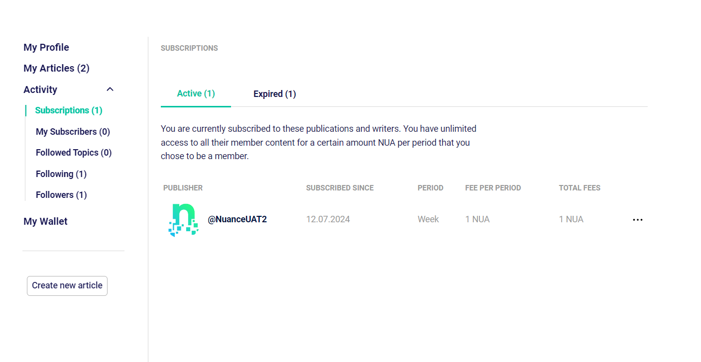
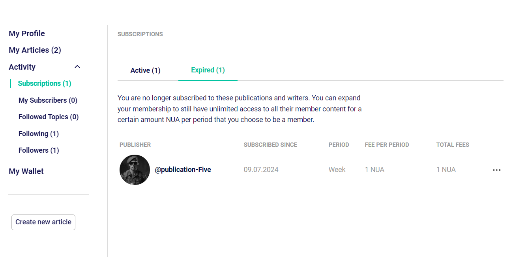
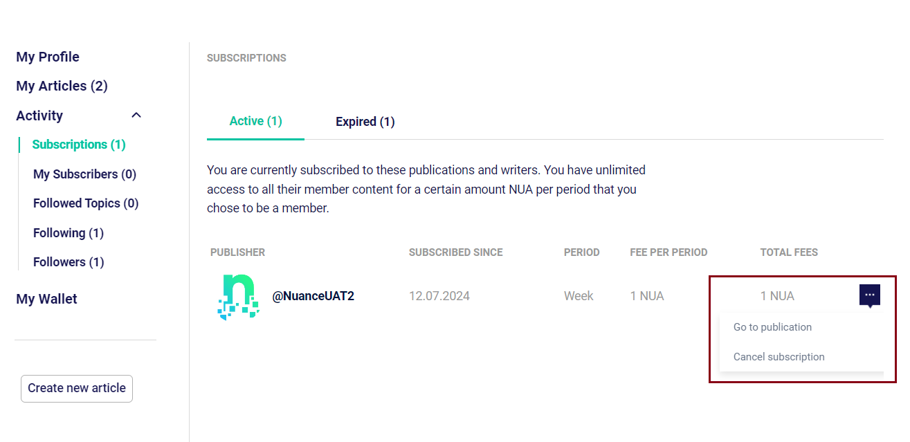
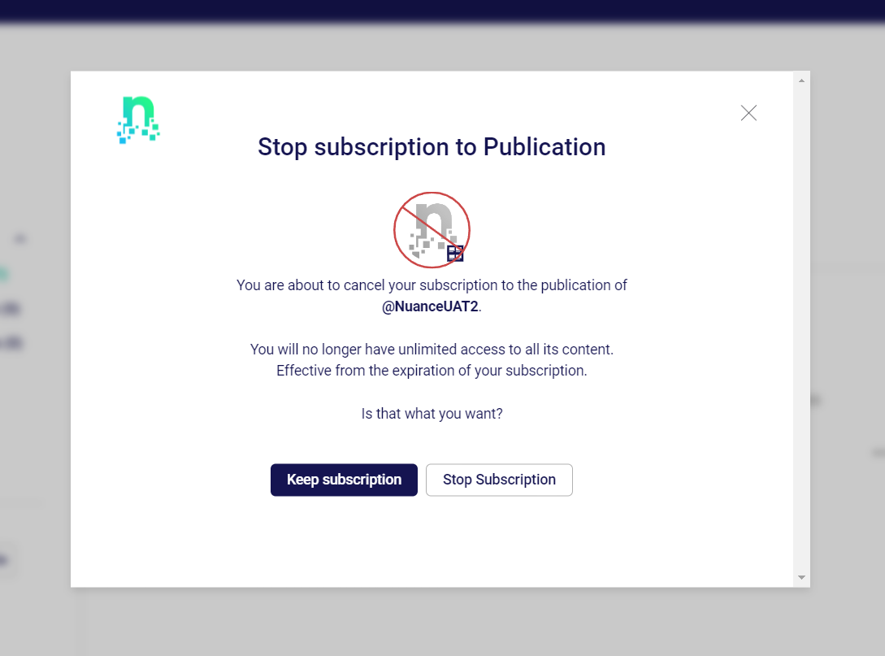

# How to Manage Your Subscriptions

To see and manage subscriptions, you can navigate to your profile and locate the **Subscriptions** under the **Activity** dropdown on the left panel of your profile page. This allows for access and management of all your subscriptions.

<figure><figcaption>
Your Subscriptions
</figcaption></figure>

There are two tabs in the subscription section: **Active** and **Expired**.

On the **Active** tab, you can find and manage your ongoing subscriptions. The **Expired** tab allows you to view your past subscriptions, providing a record of services you previously subscribed to.

<figure><figcaption>
Expired Subscriptions
</figcaption></figure>

To cancel a subscription, go to the **Active** tab and find the subscription you want to cancel. Click the meatball menu next to it, then choose **Cancel subscription**.

<figure><figcaption>
Cancelling subscription
</figcaption></figure>

A confirmation screen will appear after you click **Cancel subscription**. Pressing the **Stop subscription** button will finalize the process, and you will be unsubscribed from the publcation or user.

<figure><figcaption>
Finalizing Unsubscription
</figcaption></figure>

