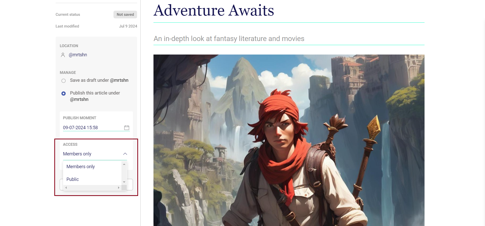

# How To Publish Members-Only Article

Creating a members-only article is almost the same as creating a regular article. The main difference lies in configuring access settings to restrict the article to members only.&#x20;

After creating your article, you can make your content members-only by clicking on the **ACCESS** dropbox on the left panel.&#x20;

<figure><figcaption>
Setting Up Access
</figcaption></figure>

After selecting the membership option, click the **Publish** button to finalize your article. This action will ensure that your content is available exclusively to members only.
