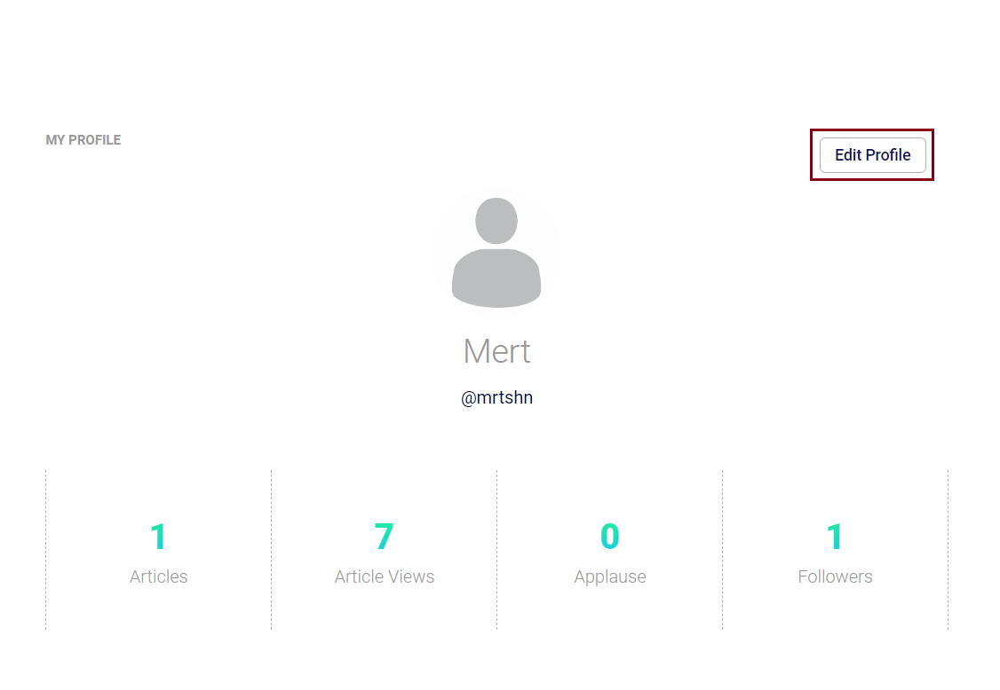
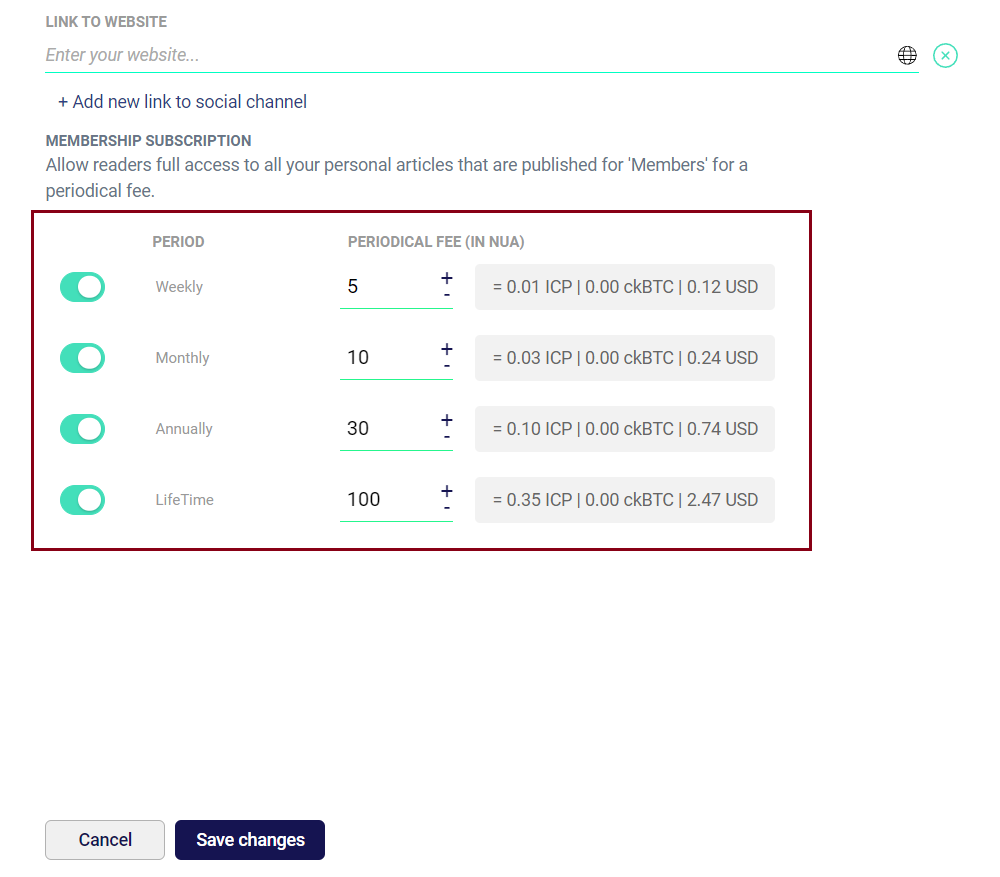

# How to Setup a Membership Subscriptions

To see your Membership Subscription options, you can go to your profile page by clicking on the **Profile Icon > My Profile** and click on the **Edit Profile** button.

<figure><figcaption>
Edit Profile
</figcaption></figure>

At the bottom of your profile editing page, you will see the panel with Membership Subscription settings. With the toggle-bar, you can activate any or all of the weekly, monthly, annual or lifetime options and set a price.

<figure><figcaption>
Setting Up Membership Options
</figcaption></figure>

After confirming your preferences, the option to publish your content as members-only will be active on the article creation screen.
