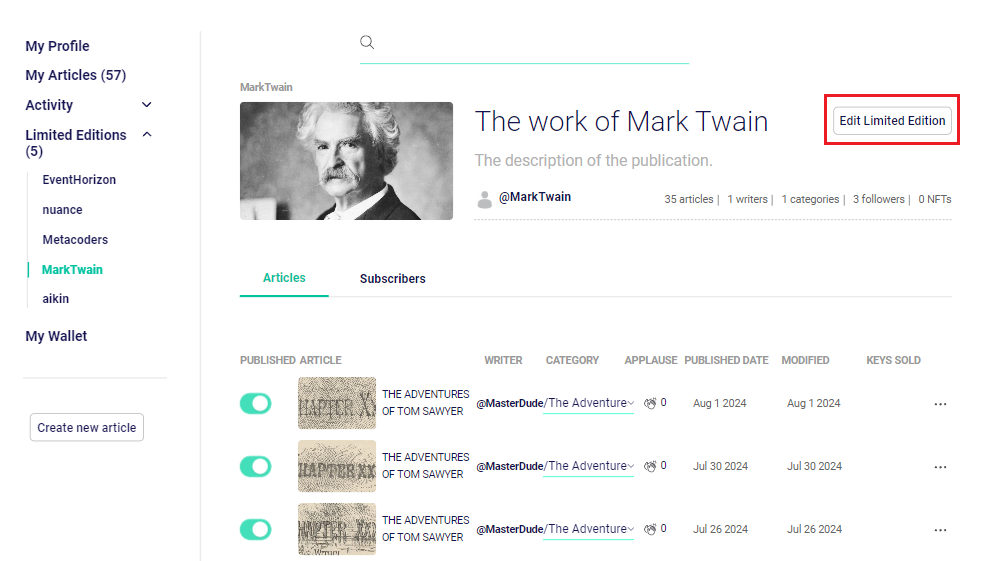

# How to Setup Membership Subscriptions for Limited Editions

You can configure Limited Edition membership access settings on the Edit Limited Edition page.&#x20;

To access the Edit Publication page, click the **profile icon** in the top-right corner and select your Limited Edition's name from the dropdown menu. Alternatively, you can click on **My Profile**, select your Limited Edition from the left panel on your profile page, then click the **Edit Limited Edition** button.

<figure><figcaption>
Edit Limited Edition Button
</figcaption></figure>

At the bottom of the page, you will find the **Membership Subscription** options. Here you can configure your subscription model and fees.

<figure><figcaption>
Subscription Options
</figcaption></figure>

To receive payments for your Limited Edition, you need to provide a Principal ID on **PAYMENT ADRESS** box.
