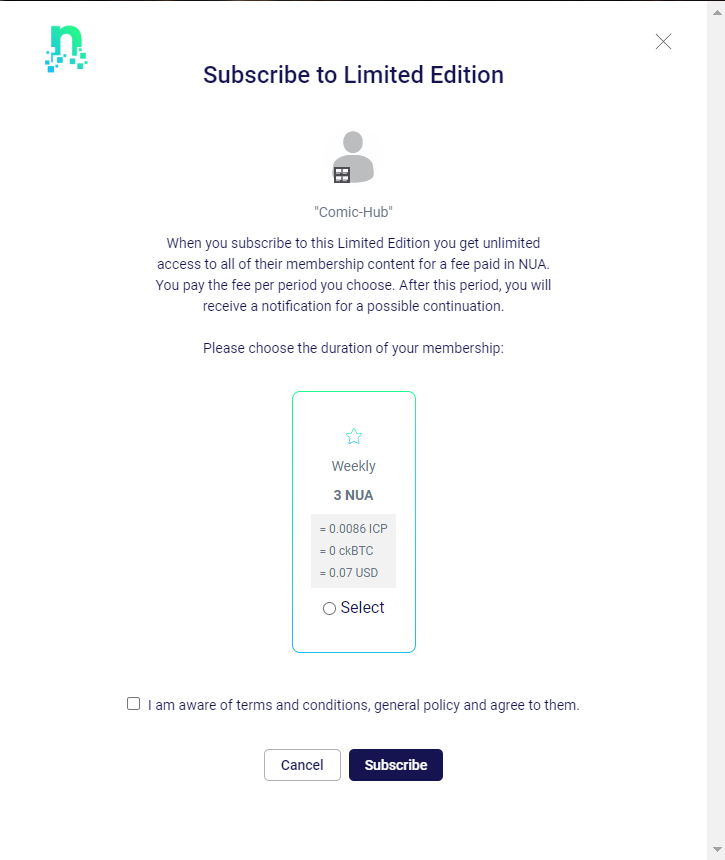
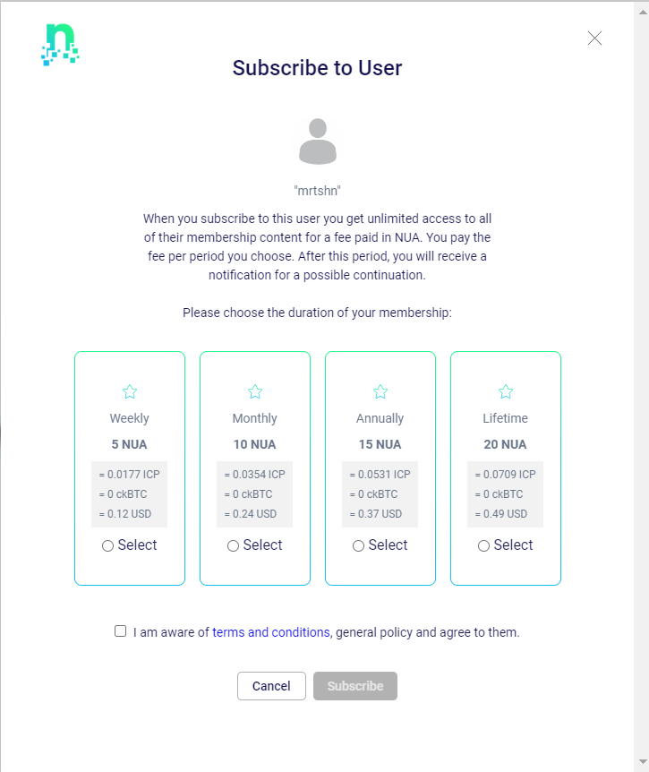
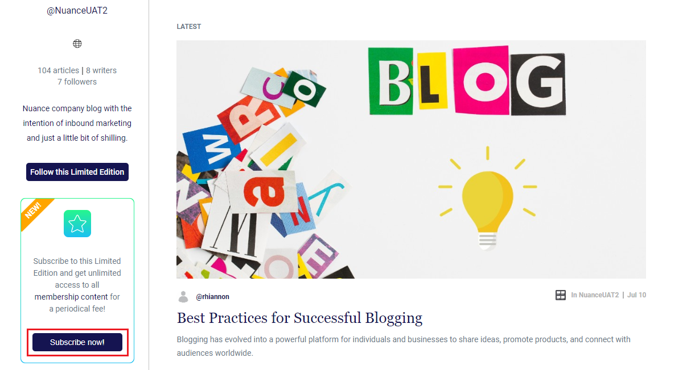
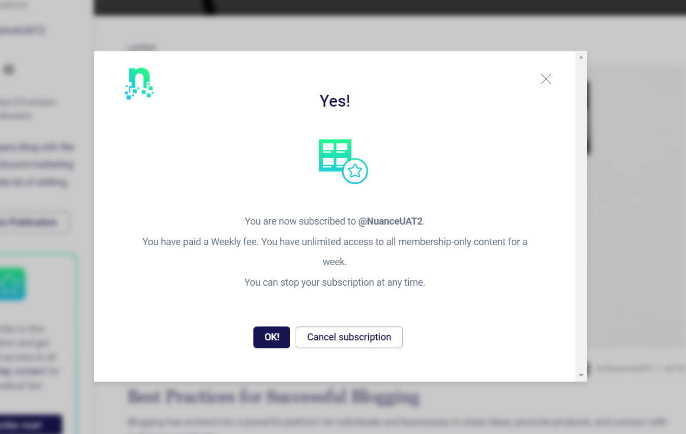

# How to Subscribe as a Member

You can subscribe to view Members only articles and gain access to exclusive content from various authors and Limited Editions. By becoming a member, you'll receive insightful articles, in-depth analyses, and unique perspectives that are not available non members.

When you encounter any members-only article, the subscription panel opens automatically.

<figure><figcaption>
Subscribe to Limited Edition
</figcaption></figure> <figure><figcaption>
Subscribe to User
</figcaption></figure>

You can also click on the Limited Edition or writer's name to access their profile or Limited Edition page, where a subscribe button will be visible if there are any available membership options. This allows you to easily explore and support your favorite authors and Limited Editions.

<figure><figcaption>
Subscribing to Limited Edition
</figcaption></figure> <figure><figcaption>
Subscribing to User
</figcaption></figure>

After choosing a membership option -such as weekly, monthly, annually, or lifetime- and subscribing,  all members-only content will become available.&#x20;

<figure><figcaption>
Congratulations!
</figcaption></figure>
